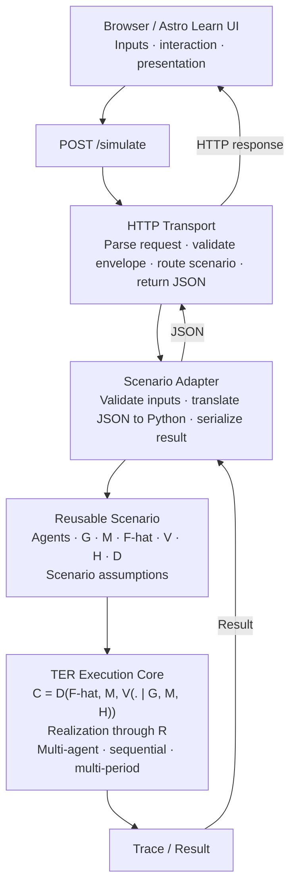

# Theory of Economic Relativity — website

The public TER website and its Learn interface, built with Astro. Interactive
Learn scenarios run in a small Python simulator that executes the TER core in
`research/`.

## Local development

Requirements: Node.js 22.12+ with npm, and Python 3.14.

Install dependencies once, from `applications/web`:

```bash
npm install
```

Start the simulator and the website together from the repository root;
Ctrl+C stops both:

```bash
./scripts/dev-simulator.sh
```

- Simulator: `http://127.0.0.1:8000`
- Website: `http://localhost:4321`

For frontend-only work, run Astro alone from `applications/web`. Interactive
scenarios then show an endpoint error.

```bash
npm run dev
```

## Validation and build

From `applications/web`:

```bash
npm run check   # Astro and TypeScript checks
npm run build   # check, then static build into dist/
```

## Simulator architecture

```text
browser → POST /simulate → scenario adapter → scenario → TER core
```

- Python owns the executable economics, including defaults and action
  selection.
- The browser owns interaction and presentation. It must not duplicate TER
  decision logic.

The page posts `{"scenario": "basic-agent-choice", "inputs": {...}}` to
`PUBLIC_TER_API_URL` + `/simulate`. Empty `inputs` runs the Python defaults.
`PUBLIC_TER_API_URL` is read at build time. `astro dev` defaults it to
`http://127.0.0.1:8000`; `astro build` fails if it is unset.

## Production

Two Cloudflare Workers, each with its own Wrangler config:

| Worker | Config | Serves |
| --- | --- | --- |
| `theory-of-economic-relativity` | `applications/web/wrangler.jsonc` | `dist/` at `https://www.theoryofeconomicrelativity.com` |
| `theory-of-economic-relativity-api` | `wrangler.api.jsonc` | `POST /simulate` at `https://api.theoryofeconomicrelativity.com` |

The website deploys through Cloudflare's Git integration on every push to
`main`. The simulator deploys when a GitHub Release is published:

1. Merge to `main` and update `VERSION`, `CITATION.cff`, and
   `theory/academic.md` to the new version.
2. Publish a GitHub Release with a new tag such as `v0.5.3`. Pre-releases do
   not deploy.
3. `.github/workflows/deploy-api.yml` checks out that tag, runs the TER test
   suite, deploys `wrangler.api.jsonc`, and runs
   `scripts/smoke_test_api.py`. The smoke test POSTs Feasible Set Learning
   to production and fails unless the response matches the same run locally.
   To deploy the same tag again, re-run the workflow from the Actions tab.

The workflow needs two GitHub repository secrets (Settings → Secrets and
variables → Actions):

- `CLOUDFLARE_API_TOKEN`: a custom token from the "Edit Cloudflare Workers"
  template, scoped to this account and the `theoryofeconomicrelativity.com`
  zone (Account › Workers Scripts: Edit, Zone › Workers Routes: Edit).
- `CLOUDFLARE_ACCOUNT_ID`: the Cloudflare account that owns both Workers.

Manual deploys still work:

```bash
# Website, from applications/web
npm run build && npx wrangler deploy

# Simulator, from the repository root
npx wrangler deploy --config wrangler.api.jsonc

# Check the production simulator, from the repository root
python3 scripts/smoke_test_api.py
```

- Production builds take `PUBLIC_TER_API_URL` from the Cloudflare build
  settings, or locally from the git-ignored `.env.production`.
- The simulator allows browser calls only from `TER_ALLOWED_ORIGIN` in
  `wrangler.api.jsonc`, accepts 30 requests a minute per IP, and rejects
  bodies over 64 KiB.
- `TER_ALLOWED_ORIGIN` is the `www` origin, so before release the Cloudflare
  account must redirect `theoryofeconomicrelativity.com` to `www`.

## Project map

```text
src/pages/learn/                                   Learn index and scenario pages
src/data/learn/scenarios.ts                        Learn scenario content
src/components/learn/                              Learn page components
src/components/learn/BasicAgentChoiceRunner.astro  Basic Agent Choice UI
src/components/learn/BoundedRationalityRunner.astro  Bounded Rationality UI
src/components/learn/AsymmetricInformationRunner.astro  Asymmetric Information UI
src/components/learn/FeasibleSetLearningRunner.astro  Feasible Set Learning UI
src/pages/                                         Other site routes
src/styles/global.css                              Global styles

# Repository root
scripts/dev-simulator.sh                           Runs simulator and website
scripts/smoke_test_api.py                          Checks a deployed simulator
.github/workflows/deploy-api.yml                   Deploys the simulator on release
wrangler.api.jsonc                                 Simulator Worker config
applications/api/endpoint.py                       Rules shared by both servers
applications/api/simulation.py                     Local POST /simulate server
applications/api/worker.py                         Production POST /simulate Worker
research/adapters/                                 JSON adapter per scenario
research/scenarios/                                Scenario definitions
research/ter/                                      TER core
```


## TER SIMULATOR ARCHITECTURE


